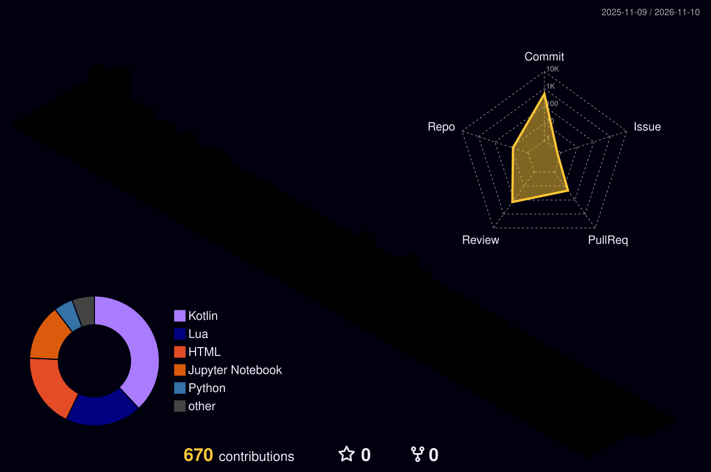

###

<h1 align="center">hey there 👋</h1>

###

<h3 align="left">👩‍💻  About Me</h3>

###

I am Xuanming Ding（丁宣铭）, an undergraduate student in the ACM Honor Class at SJTU  I am currently studying computer science and conducting research on computer audition at the <a href="https://x-lance.sjtu.edu.cn/" target="_blank">X-LANCE Lab</a>. I am particularly interested in general-purpose audio understanding and generation, as well as multi-speaker speech recognition.  - ⚡ Interested in games and animations - ✨ My name comes from Konpaku Youmu, a character in Touhou Project - 📫 How to reach me: dxuanming@sjtu.edu.cn - 🌐 Academic Homepage: <a href="https://konpaku-ming.github.io/home/" target="_blank"> Xuanming Ding</a> - 📝 Blog: <a href="https://konpaku-ming.github.io/blog/" target="_blank"> Youming's Gensokyo </a>

###

<h3 align="left">🛠 Language and tools</h3>

###

I learned C++ and Python in foundational courses and encountered PyTorch through machine learning. I learned Rust through the <a href="https://github.com/konpaku-ming/Raytracer-2025" target="_blank">Raytracer-2025</a> course project, and Kotlin through the <a href="https://github.com/konpaku-ming/Rx-Compiler" target="_blank">Rx-Compiler</a> course project.

  
  
  
  
  
  
  
  
  

###

  <!-- Streak Stats -->
  
  
  <!-- Trophy Stats -->
  

###

  

